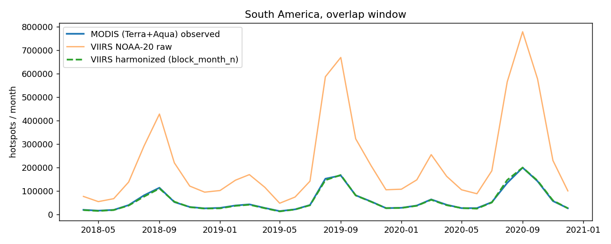
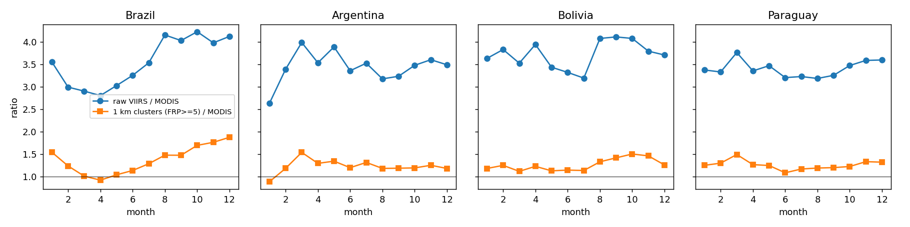
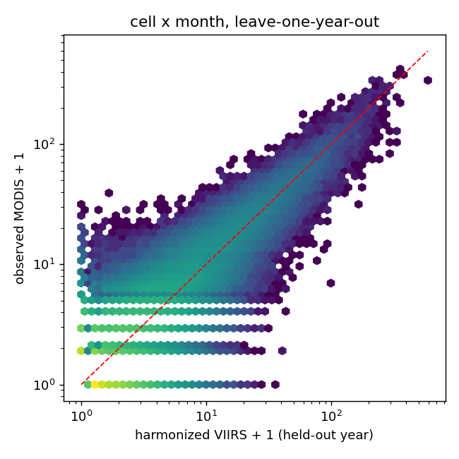
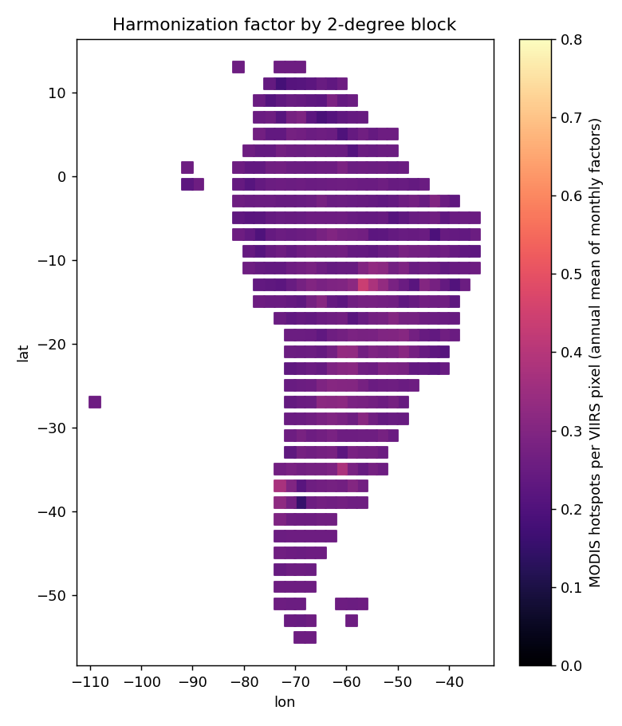

# Harmonization validation

Overlap window: 2018-04-01 to 2020-12-31. Cell size 0.1 deg. Cell-days in overlap: 2,541,034. Years held out one at a time: [2018, 2019, 2020].

All models are linear ratio estimators (MODIS = f x VIIRS metric) with empirical-Bayes shrinkage (alpha=3000 toward the region factor, beta=20000 toward the continental factor). Power-law and FRP-covariate alternatives were tested in `pipeline/experiments/powerlaw_test.py` and performed worse at every aggregation level.

## Model comparison (leave-one-year-out)

| model                 | metric   | region    | by_month   |   mean_rank |   cellmonth_r2 |   cellmonth_r2_log |   ctrymonth_r2 |   ctrymonth_nrmse |   ctryweek_nrmse |   ctrymonth_bias |
|:----------------------|:---------|:----------|:-----------|------------:|---------------:|-------------------:|---------------:|------------------:|-----------------:|-----------------:|
| block_month_n         | n        | block     | True       |        1.5  |          0.803 |              0.499 |          0.991 |             0.263 |            0.368 |            0.001 |
| block_n               | n        | block     | False      |        2.25 |          0.804 |              0.495 |          0.99  |             0.28  |            0.385 |            0.006 |
| country_n             | n        | country   | False      |        3.5  |          0.786 |              0.493 |          0.99  |             0.279 |            0.391 |            0.008 |
| block_month_n1km_f5   | n_1km_f5 | block     | True       |        5.25 |          0.809 |              0.432 |          0.99  |             0.287 |            0.401 |           -0.003 |
| country_month_n       | n        | country   | True       |        5.25 |          0.778 |              0.491 |          0.99  |             0.284 |            0.393 |            0.009 |
| global_month_n        | n        | continent | True       |        5.5  |          0.796 |              0.488 |          0.99  |             0.285 |            0.395 |            0.003 |
| naive_global_n        | n        | continent | False      |        6.25 |          0.796 |              0.489 |          0.989 |             0.303 |            0.41  |            0.004 |
| country_month_n1km_f5 | n_1km_f5 | country   | True       |        7.75 |          0.784 |              0.429 |          0.989 |             0.293 |            0.416 |            0     |
| country_month_n1km    | n_1km    | country   | True       |        7.75 |          0.741 |              0.428 |          0.99  |             0.28  |            0.422 |           -0     |

Selection: lowest mean rank over cell x month R2 (linear and log), country x month NRMSE and country x week NRMSE.

**Selected model: `block_month_n`** (metric `n`, region `block`, monthly factors: True). Continental factor: 0.257 MODIS hotspots per VIIRS pixel.

## Equivalent country x month factors (MODIS hotspots per VIIRS pixel)

| country          |       1 |     2 |     3 |     4 |       5 |       6 |       7 |     8 |     9 |    10 |    11 |    12 |
|:-----------------|--------:|------:|------:|------:|--------:|--------:|--------:|------:|------:|------:|------:|------:|
| Argentina        |   0.364 | 0.295 | 0.255 | 0.284 |   0.261 |   0.298 |   0.284 | 0.315 | 0.309 | 0.288 | 0.279 | 0.288 |
| Bolivia          |   0.27  | 0.259 | 0.274 | 0.254 |   0.285 |   0.296 |   0.31  | 0.246 | 0.244 | 0.246 | 0.263 | 0.268 |
| Brazil           |   0.28  | 0.328 | 0.341 | 0.352 |   0.327 |   0.306 |   0.283 | 0.241 | 0.248 | 0.237 | 0.252 | 0.243 |
| Chile            |   0.325 | 0.281 | 0.292 | 0.319 |   0.308 |   0.27  |   0.263 | 0.262 | 0.312 | 0.369 | 0.355 | 0.358 |
| Colombia         |   0.245 | 0.249 | 0.248 | 0.224 |   0.228 |   0.204 |   0.202 | 0.198 | 0.19  | 0.221 | 0.238 | 0.26  |
| Ecuador          |   0.229 | 0.232 | 0.253 | 0.285 |   0.251 |   0.192 |   0.196 | 0.205 | 0.195 | 0.2   | 0.212 | 0.211 |
| Falkland_Islands | nan     | 0.257 | 0.256 | 0.256 | nan     | nan     | nan     | 0.256 | 0.255 | 0.256 | 0.256 | 0.256 |
| French_Guiana    |   0.253 | 0.253 | 0.254 | 0.253 |   0.254 |   0.255 |   0.256 | 0.252 | 0.25  | 0.242 | 0.257 | 0.253 |
| Guyana           |   0.211 | 0.215 | 0.185 | 0.208 |   0.219 |   0.223 |   0.226 | 0.225 | 0.215 | 0.212 | 0.218 | 0.214 |
| Paraguay         |   0.297 | 0.3   | 0.269 | 0.298 |   0.289 |   0.31  |   0.309 | 0.314 | 0.307 | 0.288 | 0.28  | 0.281 |
| Peru             |   0.182 | 0.167 | 0.2   | 0.2   |   0.186 |   0.182 |   0.198 | 0.2   | 0.251 | 0.197 | 0.176 | 0.168 |
| Suriname         |   0.249 | 0.243 | 0.242 | 0.238 |   0.245 |   0.245 |   0.245 | 0.244 | 0.238 | 0.231 | 0.246 | 0.241 |
| Uruguay          |   0.318 | 0.292 | 0.279 | 0.294 |   0.29  |   0.283 |   0.287 | 0.293 | 0.304 | 0.313 | 0.334 | 0.337 |
| Venezuela        |   0.24  | 0.231 | 0.216 | 0.199 |   0.217 |   0.261 |   0.279 | 0.282 | 0.266 | 0.293 | 0.274 | 0.292 |

Country-level relative error of the selected model (NRMSE at country x month, held-out years):

| country          |   rel_err |
|:-----------------|----------:|
| Argentina        |     0.095 |
| Bolivia          |     0.29  |
| Brazil           |     0.117 |
| Chile            |     0.196 |
| Colombia         |     0.105 |
| Ecuador          |     0.313 |
| Falkland_Islands |     5.245 |
| French_Guiana    |     0.614 |
| Guyana           |     0.344 |
| Paraguay         |     0.069 |
| Peru             |     0.486 |
| Suriname         |     0.332 |
| Uruguay          |     0.374 |
| Venezuela        |     0.101 |

## Figures

